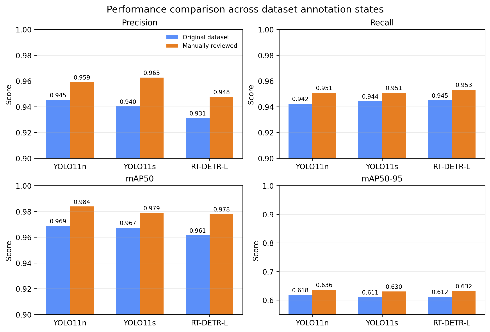
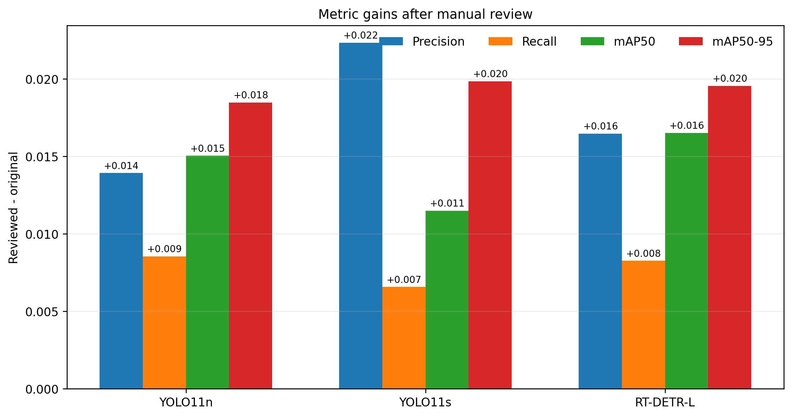
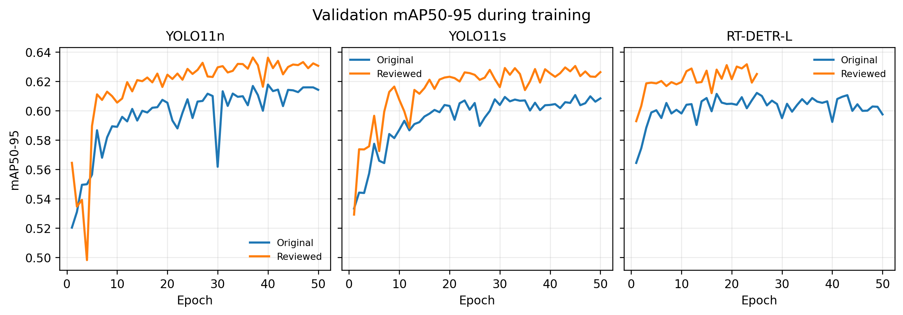

# 对比实验

## 1 实验设置

为量化人工复核标注质量对牙齿检测性能的影响，本文在统一实验协议下开展成对对照实验。选取 YOLO11n、YOLO11s、YOLOv8m、YOLO26m 四种 CNN 检测模型与 RT-DETR-L 一种 Transformer 检测模型作为基线，分别在原始 OMNI_COCO 数据集与人工复核后的数据集上训练。两组数据版本在图像划分与样本数量上保持一致，仅标注内容存在差异。所有模型均采用公开发布的预训练参数初始化，输入尺寸为 1024，训练 50 个 epoch，随机种子固定为 0，开启确定性训练与混合精度，验证集为 val 集。评价指标为 Precision、Recall、mAP@0.5 与 mAP@0.5:0.95，其中 mAP@0.5:0.95 对多个 IoU 阈值取平均，最能反映边界框的定位质量。为消除单次训练波动的影响并便于公平比较，本文报告各模型在验证集上各指标达到的最佳值。

## 2 对比实验结果

表 1 给出了五种模型在原始与人工复核后两个数据版本上的检测结果。总体而言，人工复核后的标注在全部五种模型、四项指标上均取得提升，且这一现象跨越 CNN 与 Transformer 两类架构，表明标注质量改进带来的收益具有普遍性。

| 模型 | 数据版本 | Precision | Recall | mAP@0.5 | mAP@0.5:0.95 |
| --- | --- | ---: | ---: | ---: | ---: |
| YOLO11n | 原始数据集 | 0.94519 | 0.94945 | 0.96997 | 0.61778 |
| YOLO11n | 人工复核后 | 0.96169 | 0.95588 | 0.98439 | 0.63625 |
| YOLO11s | 原始数据集 | 0.94496 | 0.94838 | 0.96805 | 0.61062 |
| YOLO11s | 人工复核后 | 0.96256 | 0.95656 | 0.98305 | 0.63046 |
| YOLOv8m | 原始数据集 | 0.94171 | 0.94320 | 0.96656 | 0.60833 |
| YOLOv8m | 人工复核后 | 0.95810 | 0.94875 | 0.97765 | 0.62935 |
| YOLO26m | 原始数据集 | 0.94687 | 0.95209 | 0.96922 | 0.61432 |
| YOLO26m | 人工复核后 | 0.96293 | 0.95586 | 0.98466 | 0.63199 |
| RT-DETR-L | 原始数据集 | 0.93651 | 0.95001 | 0.96633 | 0.61209 |
| RT-DETR-L | 人工复核后 | 0.95239 | 0.95664 | 0.98116 | 0.63845 |

表 1 五种模型在原始与人工复核后数据集上的检测结果（最佳值）

## 3 结果分析

为更直观地考察标注质量对各指标的影响，表 2 列出人工复核后相对于原始数据集的指标变化量。可以看出，所有模型的 Precision、Recall、mAP@0.5 与 mAP@0.5:0.95 均呈正增长，说明人工复核同时减少了误检与漏检，并改善了综合检测能力。

| 模型 | ΔPrecision | ΔRecall | ΔmAP@0.5 | ΔmAP@0.5:0.95 |
| --- | ---: | ---: | ---: | ---: |
| YOLO11n | +0.01650 | +0.00643 | +0.01442 | +0.01847 |
| YOLO11s | +0.01760 | +0.00818 | +0.01500 | +0.01984 |
| YOLOv8m | +0.01639 | +0.00555 | +0.01109 | +0.02102 |
| YOLO26m | +0.01606 | +0.00377 | +0.01544 | +0.01767 |
| RT-DETR-L | +0.01588 | +0.00663 | +0.01483 | +0.02636 |

表 2 人工复核后相对原始数据集的指标变化量

从表 2 可以得到三点结论。第一，Precision 的提升幅度（+0.01588 至 +0.01760）普遍高于 Recall（+0.00377 至 +0.00818），表明人工复核的收益更多体现在误检抑制而非目标覆盖数量的增加。这与复核过程删除由高光、金属托槽、弓丝等非牙体结构引起的错误框直接相关。第二，mAP@0.5:0.95 的提升幅度在所有模型中均高于 mAP@0.5，说明标注质量改善主要集中于边界框的精细定位与高 IoU 匹配质量，而非仅增加低阈值下的检出数量。第三，RT-DETR-L 在 mAP@0.5:0.95 上取得最大的提升（+0.02636），表明 Transformer 检测器同样能够从更干净的标注中获益，甚至对严格定位指标的改善更为明显。

图 3 分别展示了五种模型在训练过程中 mAP@0.5:0.95 随 epoch 的变化情况，每个子图对比该模型在原始与人工复核后两个数据版本上的训练曲线。可以看出，人工复核后的数据版本在训练中后期普遍达到更高的 mAP@0.5:0.95 水平，且多数模型的收敛过程保持稳定，说明修订后的边界框监督信号更有利于模型拟合定位误差，而非仅依靠更晚的收敛点取得优势。

## 4 小结

本节的成对对照实验表明，人工复核标注能够稳定提升五种 CNN 与 Transformer 检测模型的检测性能，且收益主要集中在边界框定位质量上，表现为 mAP@0.5:0.95 的一致提升。该结果验证了将标注质量作为可量化实验变量进行系统研究的价值，也为后续在口腔影像检测中开展数据质量控制提供了直接证据。
